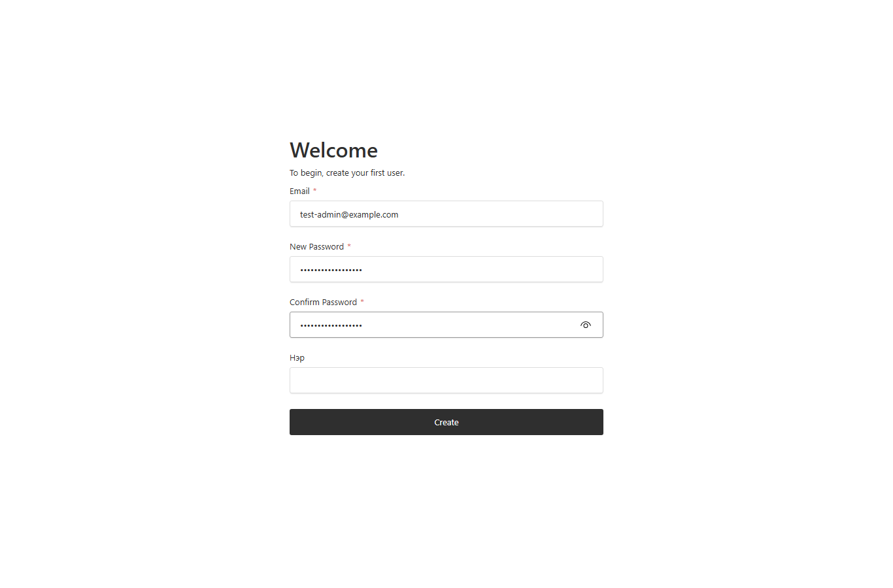
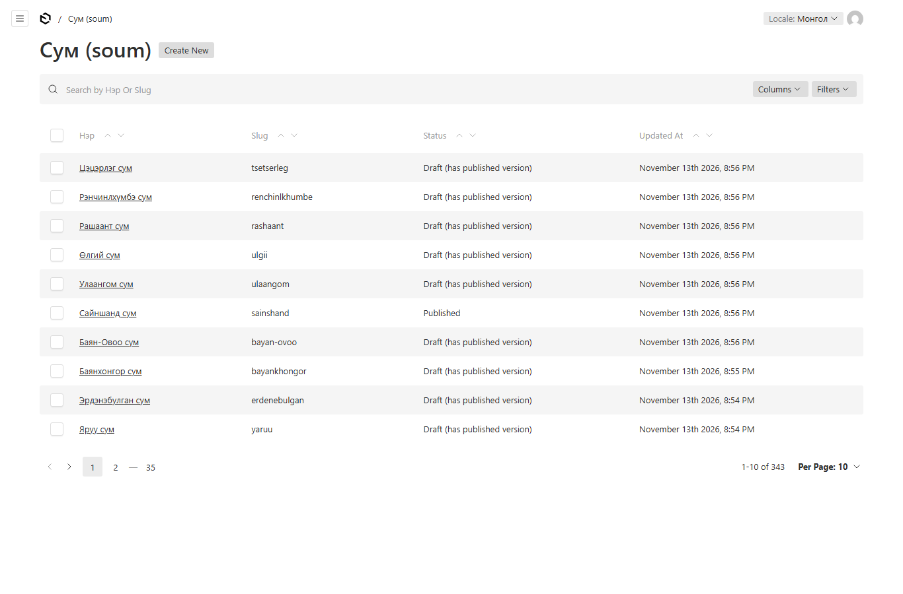
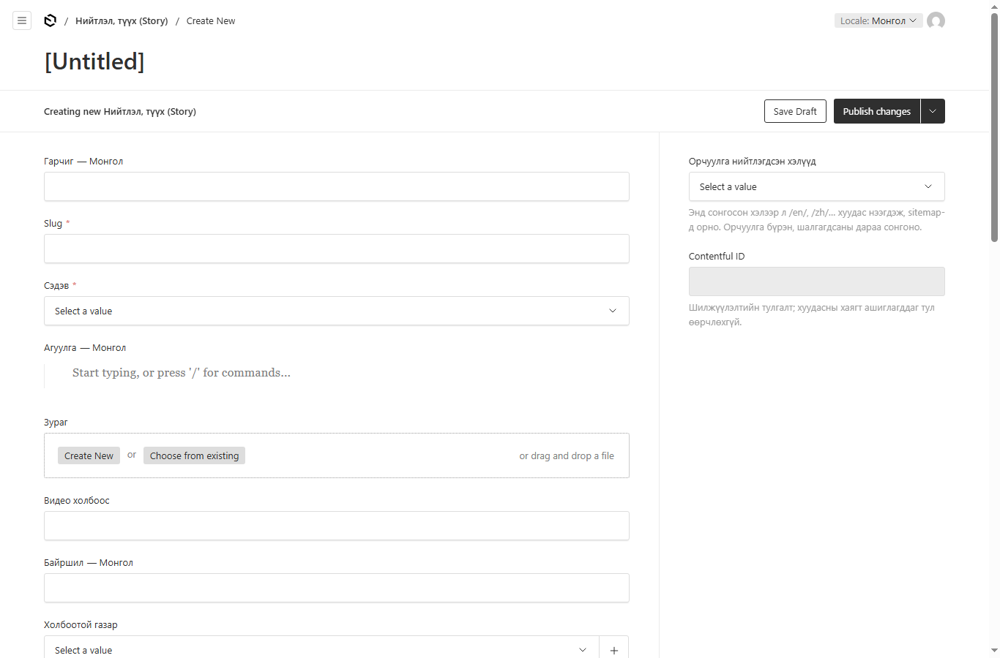
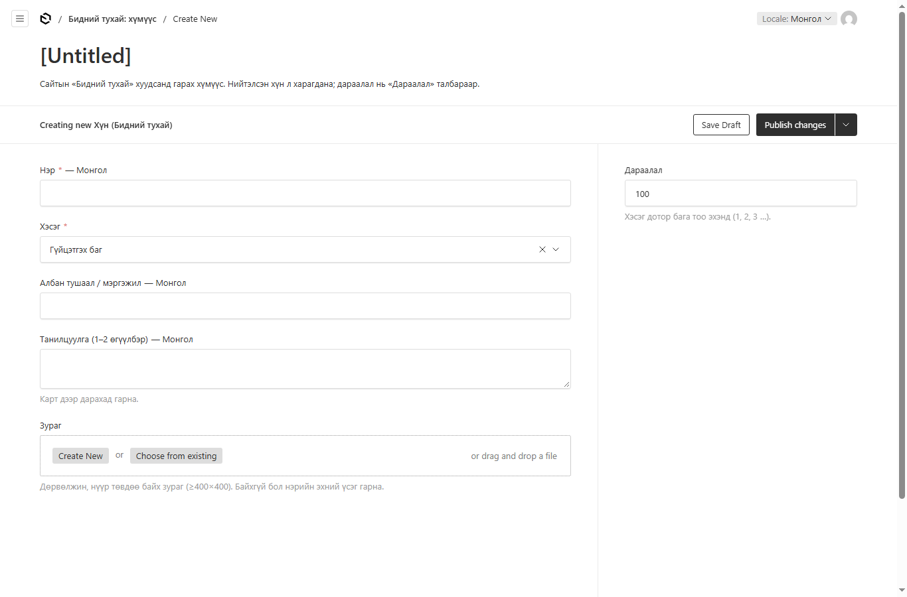

# Travel Hub Mongolia CMS — хэрэглэгчийн заавар

Сайтын агуулгыг (аймаг, сум, газар, нийтлэл, зураг, «Бидний тухай») засдаг удирдлагын хэсэг — **CMS (Payload)**.
Энэ заавар нь нэвтрэхээс эхлээд нийтлэх хүртэлх бүх алхмыг дэлгэцийн зурагтай тайлбарлана.

> **Хаяг:** 12-р сарын 1 хүртэл — туршилтын (preview) сайтын `…/admin`; 12-р сарын 1-нээс —
> **https://www.travelhubmongolia.com/admin**.
> Удирдлагын товч, цэсний ихэнх нь **англиар** (Payload-д монгол хэл байхгүй), харин манай талбаруудын нэр,
> тайлбар монголоор. Доор англи товч бүрийг **тод** бичиж, утгыг нь хаалтад өгсөн.

**Агуулга**

1. [Анхны бүртгэл (нэг л удаа)](#1-анхны-бүртгэл-нэг-л-удаа)
2. [Нэвтрэх, гарах](#2-нэвтрэх-гарах)
3. [Нууц үг: хэнтэй хуваалцах, хаана хадгалах](#3-нууц-үг-хэнтэй-хуваалцах-хаана-хадгалах)
4. [Хуудас засах](#4-хуудас-засах)
5. [Ноорог хадгалах, preview харах, нийтлэх](#5-ноорог-хадгалах-preview-харах-нийтлэх)
6. [Шинэ нийтлэл нэмэх](#6-шинэ-нийтлэл-нэмэх)
7. [Зураг оруулах](#7-зураг-оруулах)
8. [Хэлний хувилбар засах](#8-хэлний-хувилбар-засах)
9. [«Бидний тухай»-д хүн нэмэх](#9-бидний-тухай-д-хүн-нэмэх)
10. [Түгээмэл асуудал](#10-түгээмэл-асуудал)
11. [Техникийн тэмдэглэл (хөгжүүлэгчид)](#11-техникийн-тэмдэглэл-хөгжүүлэгчид)

---

## 1. Анхны бүртгэл (нэг л удаа)

CMS-д хэрэглэгч нэг ч байхгүй үед `/admin` хаяг **«Welcome — To begin, create your first user»** хуудсыг харуулна.
Эхний хэрэглэгч үүссэн даруйд энэ хуудас **үүрд хаагдана** (дахин нээвэл нэвтрэх хуудас гарна, гадны хүн «анхны
админ» болж чадахгүй). Production сайт дээр энэ хуудас ажиллахгүй — зөвхөн preview дээр үүсгэнэ.

1. Preview сайтын хаягийн ард `/admin` нэмж нээнэ (жишээ `https://….vercel.app/admin`). Vercel нэвтрэлт асуувал
   өөрийн Vercel хаягаар нэвтэрнэ.
2. **Email** — хамт олны нийтлэг имэйл (жишээ `cms@…`).
3. **New Password**, **Confirm Password** — **хамгийн багадаа 12 тэмдэгт** (богино бол «Нууц үг хамгийн багадаа 12
   тэмдэгт байна» гэж хадгалахгүй). Урт өгүүлбэр маягийн нууц үг сайн: жишээ нь 4 санамсаргүй үгийг зураасаар
   холбох. Өөр сайтад ашигласан нууц үг бүү хэрэглэ.
4. **Нэр** — заавал биш.
5. **Create** дарна.

Үүний дараа шууд удирдлагын нүүр (Dashboard) нээгдэнэ:

> Одоохондоо бүх хэрэглэгч **админ** (бүх эрхтэй). Дараа нь «Редактор», «Орчуулагч» эрх нэмэх бүтэц бэлэн байгаа.
> Шинэ хэрэглэгч нэмэх: **Хэрэглэгчид (Users) → Create New** (нууц үг мөн ≥ 12 тэмдэгт).

## 2. Нэвтрэх, гарах

1. `…/admin` → **Email**, **Password** → **Login**.
2. Ажлаа дуусгаад баруун дээд дүрс → **Log out**. Олон нийтийн, бусдын компьютерт заавал гарна.

- Нэвтэрсэн хэвээр **4 цаг идэвхгүй** байвал автоматаар гарна (CMS нээлттэй, ажиллаж байх үед сунгагдана).
- Нууц үгийг **5 удаа буруу** оруулбал хаяг **15 минут түгжигдэнэ**. 15 минут хүлээнэ (өөр админ байвал
  Users → тухайн хэрэглэгч → **Force Unlock**).
- Нууц үг солих: баруун дээд дүрс → **Account** → **Change Password**.

## 3. Нууц үг: хэнтэй хуваалцах, хаана хадгалах

CMS-д нэвтрэхэд зөвхөн имэйл, нууц үг хэрэгтэй — тиймээс **нууц үг бол сайтын түлхүүр**.

**Хэнтэй хуваалцаж болох:**
- Зөвхөн CMS-д агуулга засдаг, **нэрээр нь мэдэх** багийн гишүүнтэй. Хэнд өгснөө тэмдэглэж ав.
- Хөгжүүлэгч, гадны хамтрагч, сайн дурынханд нийтлэг нууц үг өгөхгүй — тэдэнд **тусдаа хэрэглэгч** нээнэ
  (Users → Create New); ажил дуусахад тэр хэрэглэгчийг устгана.
- «Нууц үгээ илгээнэ үү» гэсэн имэйл, мессеж, утасны дуудлагад **хэзээ ч** хариулахгүй — бид асуудаггүй.

**Хэрхэн дамжуулах:**
- Биечлэн хэлэх, эсвэл нууц үгийн менежерийн «хуваалцах» (share) функцээр.
- Messenger, имэйл, Viber, групп чатад **бичихгүй** (түүх үлддэг). Аргагүй бол бичээд, хүлээн авсны дараа мессежээ
  устгана.

**Хаана хадгалах:**
- Хамгийн сайн нь **нууц үгийн менежер** (Bitwarden — үнэгүй, 1Password, Google Password Manager г.м.).
- Цаасан дээр бичвэл түгжээтэй шургуулганд; компьютерийн дэлгэц, ширээн дээр наахгүй.
- Утасны тэмдэглэл, Word/Excel файл, дэлгэцийн зураг (screenshot)-д хадгалахгүй.

**Хэзээ солих:**
- Нууц үг мэддэг хүн ажлаас гарах, хамтын ажиллагаа дуусахад — **тэр өдөрт нь**.
- Хэн нэгэнд санамсаргүй харагдсан, чатад бичигдсэн, хаяг байнга түгжигдэх болсон (таах оролдлого) үед.
- Солисон нууц үгийг зөвхөн шаардлагатай хүмүүст дахин хүргэнэ.

## 4. Хуудас засах

1. Dashboard дээр бүлгүүд: **Газар нутаг** (аймаг, сум, газар, өвийн газар…), **Түүх, соёл, байгаль**,
   **Нийтлэл, арга хэмжээ**, **Нутгийн үйлчилгээ**, **Зураг**, **Бидний тухай**, **Тохиргоо**.
2. Жишээ нь «Сум (soum)» дээр дарна → жагсаалт. Дээд талын **Search** нүдэнд нэрээр хайна.

3. Мөр дээр дарж засах хуудсыг нээнэ.

- Талбарын нэрийн ард **«— Монгол»** гэсэн нь тухайн хэлээр бичигдэх талбар (8-р хэсэг).
- **Slug** — хуудасны хаягийн хэсэг (`/province/khuvsgul/tsetserleg`). Нийтлэгдсэн хуудасны slug-ийг **өөрчлөхгүй**
  (хуучин холбоос, Google-ийн индекс эвдэрнэ).
- **Агуулга** (rich text): мөр эхэнд **/** дарж гарчиг (Heading 2/3), жагсаалт, хүснэгт, зураг оруулна. Текстийг
  тодруулж **B**, *I*, холбоос (🔗) нэмнэ.
- **Contentful ID** болон саарал талбарууд — системийнх, хөндөхгүй.
- **Versions** таб — өмнөх бүх хувилбар; хуучин хувилбарыг сэргээх боломжтой (**Restore this version**).

## 5. Ноорог хадгалах, preview харах, нийтлэх

Засах хуудасны дээд мөрөнд:

| Товч | Юу хийх |
|---|---|
| **Save Draft** (ноорог хадгалах) | Өөрчлөлтийг хадгална, **сайтад гарахгүй**. Хэдэн ч удаа дарж болно |
| **Publish changes** (нийтлэх) | Сайтад гаргана. Хэдэн секундийн дотор шинэчлэгдэнэ |
| **▾** (Publish-ийн хажуу) | **Schedule Publish** — тодорхой цагт автоматаар нийтлэх |
| **Status: Changed — Revert to published** | Нийтлэгдээгүй өөрчлөлт байна; «Revert…» дарвал ноорогийг хаяж нийтлэгдсэн хувилбар руу буцна |
| **Status: Published — Unpublish** | Хуудсыг сайтаас авна (устгахгүй). **⋮ → Delete** — бүр мөсөн устгана |

**Preview харах (ноорог сайт дээр ямар харагдахыг):**
- **Preview сайт** (`….vercel.app`) **ноорог хувилбарыг** харуулдаг. **Save Draft** дараад preview сайт дээр тухайн
  хуудсыг (жишээ `…vercel.app/province/khuvsgul/tsetserleg`) нээж, хуудсыг шинэчилнэ (F5).
- Production (`travelhubmongolia.com`) зөвхөн **нийтлэгдсэн** хувилбарыг харуулна.
- Хангалттай бол **Publish changes**.

**Ажлын дүрэм:** том засварыг эхлээд Save Draft → preview-ээр шалгах → Publish. Жижиг үсгийн алдааг шууд Publish
хийж болно.

## 6. Шинэ нийтлэл нэмэх

1. Dashboard → **Нийтлэл, арга хэмжээ → «Нийтлэл, түүх (Story)»** (эсвэл карт дээрх **+**).
2. Баруун дээд **Create New**.

3. Бөглөх:
   - **Гарчиг** — монголоор.
   - **Slug** — латинаар, жижиг үсэг, зураасаар: `dadal-altargana-nair` (зай, кирилл, том үсэг хэрэглэхгүй).
   - **Сэдэв** — жагсаалтаас.
   - **Агуулга** — текст; **/** дарж гарчиг, зураг оруулна.
   - **Зураг** — нүүр зураг (7-р хэсэг).
   - **Холбоотой газар**, **Байршил** г.м. — байгаа бол.
4. **Save Draft** → preview-ээр шалгах → **Publish changes**.

Бусад төрөл (Арга хэмжээ, Газар, Аялагчийн зөвлөмж…) ижил аргаар.

## 7. Зураг оруулах

**Аргын 1 — засаж буй хуудаснаас (хурдан):** «Зураг» талбарт **Create New** → файлаа сонгох (эсвэл чирж оруулах) →
alt текст бичих → **Save**. Байгаа зургаас сонгох бол **Choose from existing**.

**Аргын 2 — Зургийн сан:** Dashboard → **Зураг → Зургууд** → **Create New**.

- **Select a file** эсвэл чирж оруулна. JPG/PNG/WebP, **25 MB хүртэл**. Хэвтээ зургийг **≥ 1600 px** өргөнтэй.
  Систем автоматаар 480/960/1600/2400 px WebP хувилбар үүсгэнэ.
- **Гарчиг / alt текст** — зураг дээр юу байгааг 1 өгүүлбэрээр (жишээ «Хөвсгөл нуурын өвлийн мөс»). Хайлт, хараагүй
  хүмүүст чухал.
- **Тайлбар, зургийн эх сурвалж** — `Зураг: Зохиогч, лиценз | URL` хэлбэрээр; сайт дээр зургийн доор гарна.
- Зөвхөн **эрх нь танайх эсвэл чөлөөт лицензтэй** (CC BY, CC BY-SA, Unsplash г.м.) зураг оруулна.
- Голлох хэсэг тайрагдахаас сэргийлэх: зураг оруулсны дараа **focal point**-ыг (цэг) голлох хэсэг рүү зөөнө.

## 8. Хэлний хувилбар засах

Сайт 6 хэлтэй: **Монгол** (үндсэн), English, 中文, Русский, 한국어, 日本語.

1. Хуудсыг нээгээд баруун дээд **Locale: Монгол** → хэлээ сонгоно (жишээ **English**).

2. Талбарын ард **«— English»** гэж гарна. Хоосон талбар = орчуулаагүй (сайт дээр монголоор гарна).
3. Орчуулгаа бичээд **Save Draft** / **Publish changes**.
4. **«Орчуулга нийтлэгдсэн хэлүүд»** (баруун талд) — тухайн хэл **бүрэн, шалгагдсан** үед л сонгоно. Сонгосон хэлээр
   `/en/…`, `/zh/…` хуудас нээгдэж, sitemap-д орно. Хагас орчуулгыг сонгохгүй.
5. Slug, аймаг, зураг, холбоос зэрэг хэлнээс үл хамаарах талбар бүх хэлэнд нэг — аль ч хэлнээс засахад бүгдэд нөлөөлнө.

**Анхаар:** нийтлэх (Publish) нь **бүх хэлний** өөрчлөлтийг хамт нийтэлнэ. Монгол хувилбарт нийтлэгдээгүй ноорог
байхад англи орчуулгыг нийтлэвэл монгол ноорог ч хамт гарна. Монгол засварыг дуусгаад нийтэлсний дараа орчуулгаа хий.

Нэр томъёо, хэв маяг: `docs/translation/style-guide.md`, `docs/translation/glossary.csv` (сум = «soum»).

## 9. «Бидний тухай»-д хүн нэмэх

1. Dashboard → **Бидний тухай → «Бидний тухай: хүмүүс»** → **Create New**.

2. Бөглөх:
   - **Нэр** — «Овог Нэр» эсвэл «Нэр Овог» (бүгдэд нэг хэлбэр).
   - **Хэсэг** — **Зөвлөхүүд** / **Гүйцэтгэх баг** / **Уран бүтээлчид**.
   - **Албан тушаал / мэргэжил** — богино (жишээ «Түүхч, доктор (Ph.D)»).
   - **Танилцуулга** — 1–2 өгүүлбэр; карт дээр дарахад гарна.
   - **Зураг** — дөрвөлжин, нүүр голдоо, ≥ 400×400 px. Байхгүй бол нэрийн эхний үсэг дугуйд гарна.
   - **Дараалал** (баруун талд) — тухайн хэсэг дотор бага тоо эхэнд (1, 2, 3…).
3. **Publish changes**. Сайтын `/about-us` хуудас шинэчлэгдэнэ.
4. Хүнийг хасах: Status мөрийн **Unpublish** (түр нуух) эсвэл **⋮ → Delete**.

Тэмдэглэл: CMS-д нэг ч хүн нийтлэгдээгүй үед хуудас жишээ («Нэр Овог») мэдээлэл харуулна. Эхний хүнийг нийтэлмэгц
зөвхөн CMS-ийн хүмүүс гарна. «Бидний тухай» хуудас одоогоор цэсэнд нуугдмал — жинхэнэ мэдээлэл бүрэн болсны дараа
хөгжүүлэгч нээнэ.

## 10. Түгээмэл асуудал

| Асуудал | Шийдэл |
|---|---|
| «Нууц үг хамгийн багадаа 12 тэмдэгт байна» | Илүү урт нууц үг сонгоно (3-р хэсэг) |
| «Хэт олон буруу оролдлого» / хаяг түгжигдсэн | 15 минут хүлээнэ. Ойр ойрхон түгжигдвэл нууц үгээ солино |
| Нууц үгээ мартсан | «Forgot password» имэйл илгээдэггүй (имэйл тохиргоо байхгүй). Өөр админ Users → таны хэрэглэгч → **Change Password**; ганц админ бол хөгжүүлэгчид хандана |
| Нийтэлсэн ч сайт дээр хуучин | 1–2 минут хүлээгээд хуудсыг F5. Хэвээр бол хөгжүүлэгчид |
| Зураг оруулахад алдаа | Файл 25 MB-аас бага, JPG/PNG/WebP эсэх |
| `…/admin/create-first-user` production дээр алдаа өгнө | Зориуд хаасан. Хэрэглэгчийг preview дээр, эсвэл Users → Create New-ээр |

## 11. Техникийн тэмдэглэл (хөгжүүлэгчид)

- **Нэвтрэлт:** имэйл + нууц үг. **2FA унтраалттай** — `payload/security/totpOptions.ts` → `ADMIN_2FA_ENABLED = false`.
  `true` болгоход payload-totp (бүх хэрэглэгчид заавал), монгол Setup/Verify хуудас, `/admin/security` (QR дахин,
  10 нөөц код), нөөц кодын endpoint бүгд асна; дараа нь `node scripts/payload/cli.mjs generate:importmap`. DB-ийн
  багана (`totp_secret`, `recovery_codes`, `totp_attempts`) хэвээр тул migration хэрэггүй. Урсгал, туршилт:
  `docs/plan/payload-report.md` §12–13.
- **Нууц үг ≥ 12 тэмдэгт:** `payload/collections.ts` → `PASSWORD_MIN_LENGTH` (create/update — `beforeValidate`,
  reset-password — `beforeOperation`).
- **Lockout:** `maxLoginAttempts: 5`, `lockTime: 15 мин`. **Session:** `tokenExpiration` 4 цаг, cookie `Secure`
  (production), `SameSite=Lax`. Хуваалцсан нэг хаягийг гадны хүн 5 буруу нууц үгээр 15 мин түгжиж чадна —
  хүн бүрт тусдаа хаяг нь үүнийг бууруулна.
- **robots:** `app/robots.ts` → `Disallow: /admin`, admin meta `noindex`, `next.config.js` → `X-Robots-Tag: noindex`,
  `X-Frame-Options: SAMEORIGIN`, `Referrer-Policy: same-origin`.
- **Анхны хэрэглэгч:** Payload `first-register` хэрэглэгч байвал 403. Нэмэлт хамгаалалт: `VERCEL_ENV=production` үед
  нэвтрээгүй хүсэлтээр хэрэглэгч үүсгэхийг хаасан (`PAYLOAD_ALLOW_FIRST_USER=1`-ээр түр нээнэ). Хэрэглэгчийг кодоор
  үүсгэхгүй.
- **Эрх:** `ALL_USERS_ADMIN = true` (role нуугдмал, хадгалах бүрт `admin`). Editor/translator-ыг идэвхжүүлэх: `false`.
- **serverURL** зөвхөн `VERCEL_ENV=production` үед (preview-д redirect/CSRF production руу заагдахгүйн тулд).
