# Travel Hub Mongolia CMS — хэрэглэгчийн заавар

Сайтын агуулгыг (аймаг, сум, газар, нийтлэл, зураг, «Бидний тухай») засдаг удирдлагын хэсэг — **CMS (Payload)**.
Энэ заавар нь нэвтрэхээс эхлээд нийтлэх хүртэлх бүх алхмыг дэлгэцийн зурагтай тайлбарлана.

> **Хаяг:** 12-р сарын 1 хүртэл — туршилтын (preview) сайтын `…/admin`; 12-р сарын 1-нээс —
> **https://www.travelhubmongolia.com/admin**.
> Удирдлагын товч, цэсний ихэнх нь **англиар** (Payload-д монгол хэл байхгүй), харин манай талбаруудын нэр,
> тайлбар, 2FA-ийн хуудсууд монголоор. Доор англи товч бүрийг **тод** бичиж, утгыг нь хаалтад өгсөн.

**Агуулга**

1. [Анхны бүртгэл (нэг л удаа)](#1-анхны-бүртгэл-нэг-л-удаа)
2. [2 шаттай баталгаажуулалт (2FA) тохируулах](#2-2-шаттай-баталгаажуулалт-2fa-тохируулах)
3. [Нэвтрэх (өдөр бүр)](#3-нэвтрэх-өдөр-бүр)
4. [Утас гээсэн, солигдсон үед — нөөц код](#4-утас-гээсэн-солигдсон-үед--нөөц-код)
5. [Нэг хаягийг олон хүн ашиглах: шинэ утас нэмэх](#5-нэг-хаягийг-олон-хүн-ашиглах-шинэ-утас-нэмэх)
6. [Хуудас засах](#6-хуудас-засах)
7. [Ноорог хадгалах, preview харах, нийтлэх](#7-ноорог-хадгалах-preview-харах-нийтлэх)
8. [Шинэ нийтлэл нэмэх](#8-шинэ-нийтлэл-нэмэх)
9. [Зураг оруулах](#9-зураг-оруулах)
10. [Хэлний хувилбар засах](#10-хэлний-хувилбар-засах)
11. [«Бидний тухай»-д хүн нэмэх](#11-бидний-тухай-д-хүн-нэмэх)
12. [Аюулгүй байдлын дүрэм](#12-аюулгүй-байдлын-дүрэм)
13. [Түгээмэл асуудал](#13-түгээмэл-асуудал)
14. [Техникийн тэмдэглэл (хөгжүүлэгчид)](#14-техникийн-тэмдэглэл-хөгжүүлэгчид)

---

## 1. Анхны бүртгэл (нэг л удаа)

CMS-д хэрэглэгч нэг ч байхгүй үед `/admin` хаяг **«Welcome — To begin, create your first user»** хуудсыг харуулна.
Эхний хэрэглэгч үүссэн даруйд энэ хуудас **үүрд хаагдана** (дахин нээвэл нэвтрэх хуудас гарна, гадны хүн «анхны
админ» болж чадахгүй). Production сайт дээр энэ хуудас ажиллахгүй — зөвхөн preview дээр үүсгэнэ.

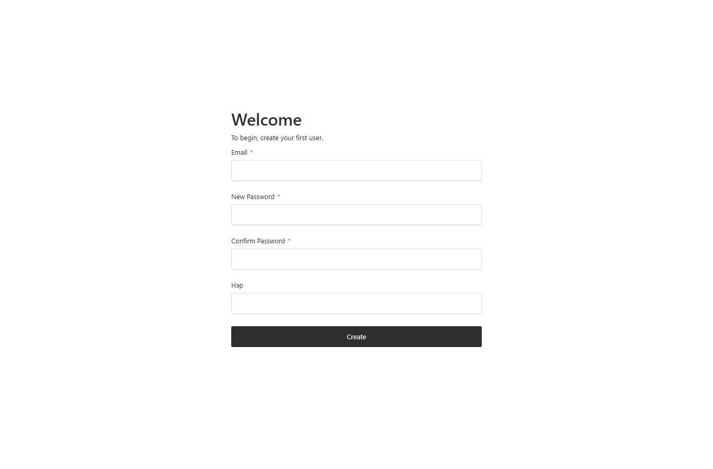

1. Preview сайтын хаягийн ард `/admin` нэмж нээнэ (жишээ `https://….vercel.app/admin`). Vercel нэвтрэлт асуувал
   өөрийн Vercel хаягаар нэвтэрнэ.
2. **Email** — хамт олны нийтлэг имэйл (жишээ `cms@…`). Нууц үг сэргээх, хэн болохыг таних хаяг.
3. **New Password**, **Confirm Password** — **16+ тэмдэгт**, урт өгүүлбэр маягийн нууц үг (жишээ: 4 санамсаргүй үг
   зураасаар). Өөр сайтад ашигласан нууц үг бүү хэрэглэ.
4. **Нэр** — заавал биш.
5. **Create** дарна.

Дараа нь шууд 2FA-ийн тохиргоо руу шилжинэ (2-р хэсэг).

> Одоохондоо бүх хэрэглэгч **админ** (бүх эрхтэй). Дараа нь «Редактор», «Орчуулагч» эрх нэмэх бүтэц бэлэн байгаа.

## 2. 2 шаттай баталгаажуулалт (2FA) тохируулах

Нэвтрэхэд нууц үгээс гадна **утасны 6 оронтой код** заавал хэрэгтэй. Нууц үг алдагдсан ч утасгүй хүн нэвтэрч чадахгүй.

**Бэлтгэл:** утсандаа **Google Authenticator** суулгана (App Store / Google Play, үнэгүй). Microsoft Authenticator,
Authy ч болно.

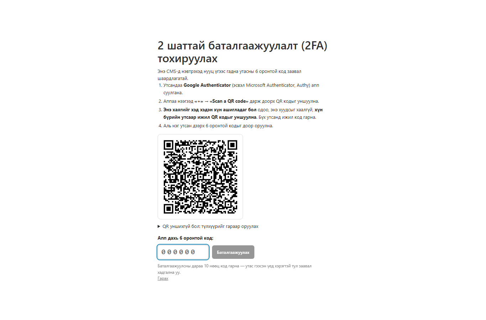
*(Зураг дээрх QR туршилтын хаягийнх — танай хуудсанд өөр QR гарна.)*

1. Google Authenticator-ийг нээгээд **«+» → «Scan a QR code»** дарж дэлгэц дээрх QR кодыг уншуулна.
   Апп-д **«Travel Hub Mongolia (таны имэйл)»** нэртэй бичлэг үүсэж, 30 секунд тутам солигдох 6 оронтой код гарна.
2. **Хаягийг хэд хэдэн хүн ашиглах бол: энэ хуудсыг хаалгүйгээр хүн бүр өөрийн утсаар ИЖИЛ QR-ийг одоо уншуулна.**
   Бүх утсанд ижил код гарна; хэн нь ч нэвтэрч болно. (Дараа нь нэмэх бол 5-р хэсэг.)
3. QR уншихгүй бол **«QR уншихгүй бол: түлхүүрийг гараар оруулах»** дээр дарж, апп-д «Enter a setup key» → түлхүүрийг
   бичнэ (Time based).
4. Апп дахь 6 оронтой кодыг **«Апп дахь 6 оронтой код»** нүдэнд бичнэ — 6 дахь оронг бичихэд автоматаар шалгана.
5. Амжилттай бол **«Аюулгүй байдал»** хуудас нээгдэж **10 нөөц код** гарна:

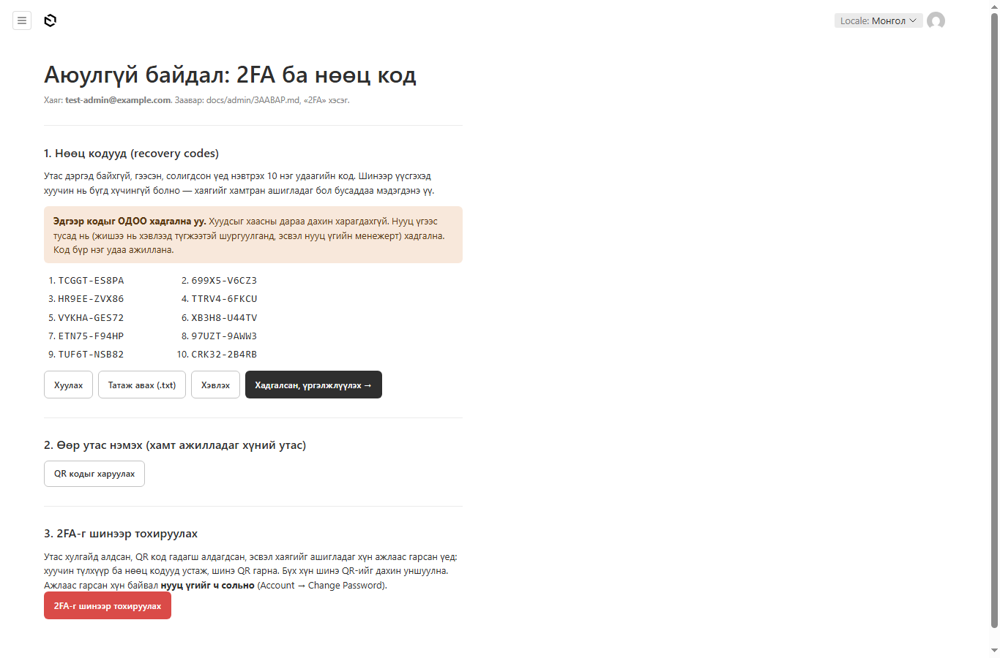

6. **Нөөц кодыг ОДОО хадгална.** Энэ хуудсыг хаасны дараа дахин харагдахгүй.
   - **Хэвлэх** → цаасаар түгжээтэй шүүгээнд, эсвэл **Татаж авах (.txt)** → нууц үгийн менежерт (1Password, Bitwarden г.м.).
   - Утсандаа зураг авч хадгалахгүй, чатаар илгээхгүй.
7. **«Хадгалсан, үргэлжлүүлэх →»** дарна. Удирдлагын нүүр (Dashboard) нээгдэнэ:

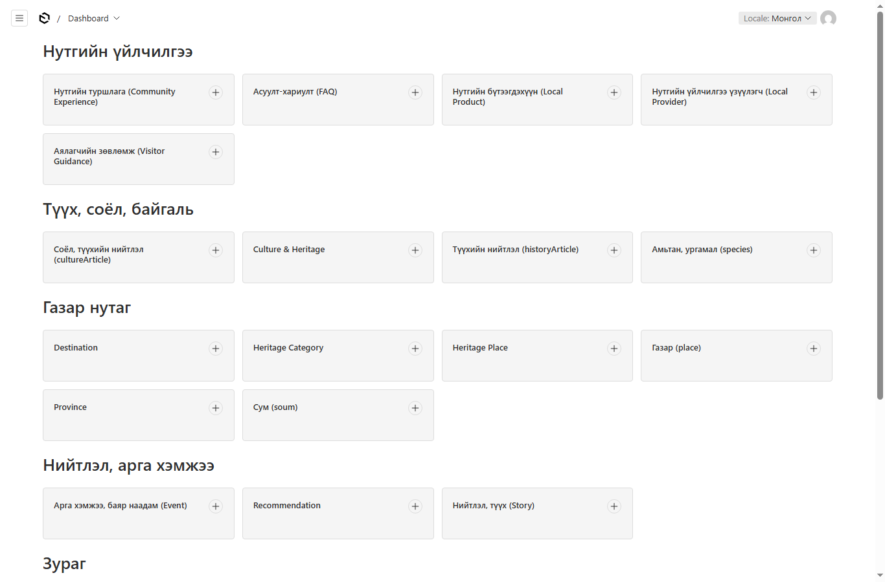

Зүүн дээд **☰** цэс → доод хэсэгт **«🔐 2FA ба нөөц код»** холбоос — 4, 5-р хэсгийн «Аюулгүй байдал» хуудас.

## 3. Нэвтрэх (өдөр бүр)

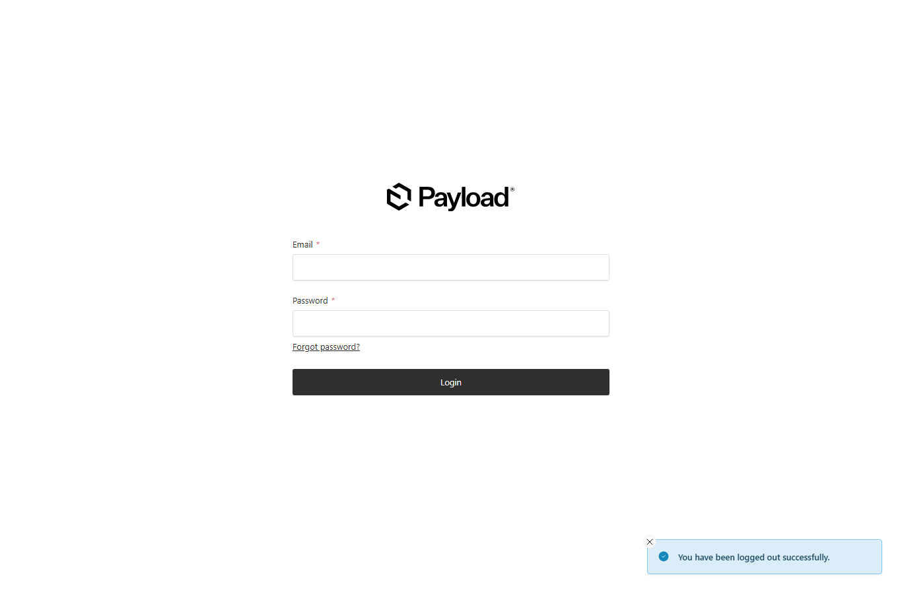

1. `…/admin` → **Email**, **Password** → **Login**.
2. **«Баталгаажуулах код»** хуудас гарна. Утасны Google Authenticator дахь **«Travel Hub Mongolia»**-гийн одоогийн
   6 оронтой кодыг бичнэ.

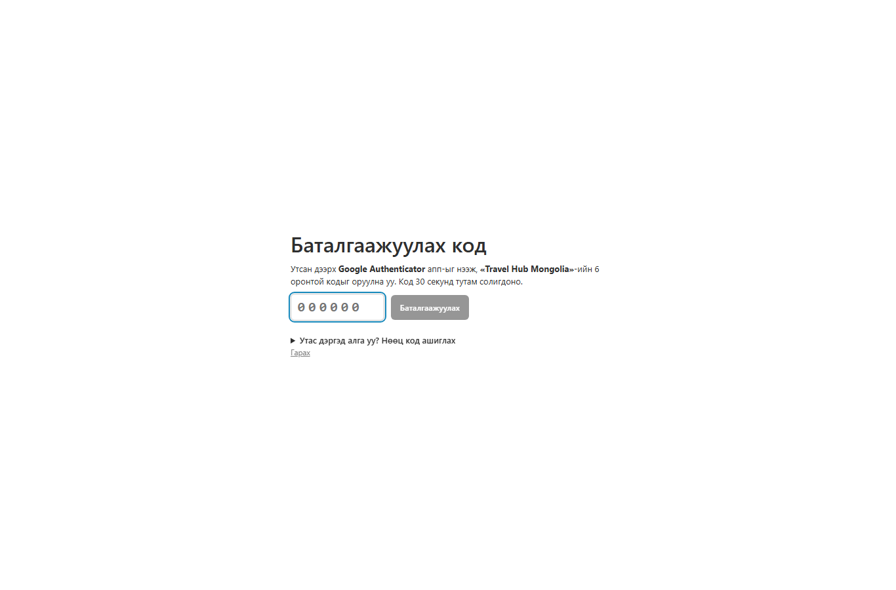

- Нэвтэрсэн хэвээр **4 цаг идэвхгүй** байвал автоматаар гарна (CMS нээлттэй, ажиллаж байх үед сунгагдана).
- Ажлаа дуусгаад баруун дээд дүрс → **Log out**. Олон нийтийн компьютерт заавал гарна.
- Нууц үг эсвэл код **5 удаа буруу** → хаяг **15 минут түгжигдэнэ**. 15 минут хүлээнэ (өөр админ байвал
  Users → тухайн хэрэглэгч → **Force Unlock**).

## 4. Утас гээсэн, солигдсон үед — нөөц код

1. Нэвтрэх хуудсанд имэйл, нууц үгээ оруулна.
2. «Баталгаажуулах код» хуудсанд **«Утас дэргэд алга уу? Нөөц код ашиглах»** дээр дарна.
3. Хадгалсан 10 кодын **аль нэгийг** (жишээ `TCGGT-ES8PA`) бичээд **«Нөөц кодоор нэвтрэх»**.
4. **«Аюулгүй байдал»** хуудас нээгдэж үлдсэн кодын тоо гарна. Тэр код **дахин ажиллахгүй** — цаасан дээрээ зурж хая.

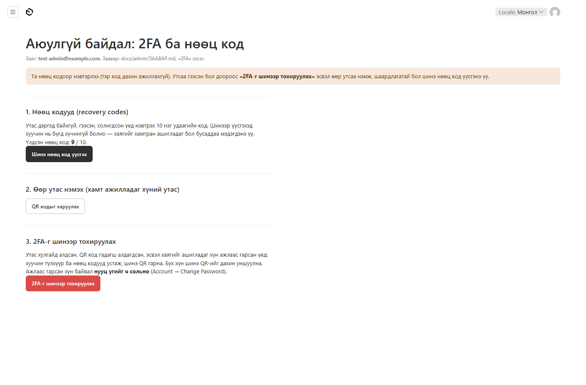

Дараа нь нөхцөлөөс хамаарч:

| Нөхцөл | Хийх |
|---|---|
| Утсаа түр мартсан | Юу ч хийхгүй. Үлдсэн код 3-аас цөөрвөл **«Шинэ нөөц код үүсгэх»** |
| Шинэ утас авсан (хуучин нь байхгүй) | **2. Өөр утас нэмэх → QR кодыг харуулах** → шинэ утсаар уншуулна |
| Утас **хулгайд** алдсан / QR гадагш алдагдсан | **3. 2FA-г шинээр тохируулах** → шинэ QR → бүх хүн дахин уншуулна; нууц үгээ ч солино |

«Шинэ нөөц код үүсгэх» дарахад **хуучин 10 код бүгд хүчингүй** болно — хаягийг хамтран ашигладаг бол бусдад хэлж,
шинэ жагсаалтыг ижил газар хадгална.

## 5. Нэг хаягийг олон хүн ашиглах: шинэ утас нэмэх

Хамт ажилладаг хүн нэмэгдвэл (эсвэл утсаа сольсон бол):

1. 2FA-тай нэвтэрсэн хүн **☰ → «🔐 2FA ба нөөц код»** нээнэ.
2. **«2. Өөр утас нэмэх» → «QR кодыг харуулах»**.
3. Шинэ хүн **биечлэн дэргэд нь** Google Authenticator → «+» → «Scan a QR code» → уншуулна. Хуучин утаснууд хэвээр
   ажиллана.
4. **«QR-ийг нуух»** дарна.

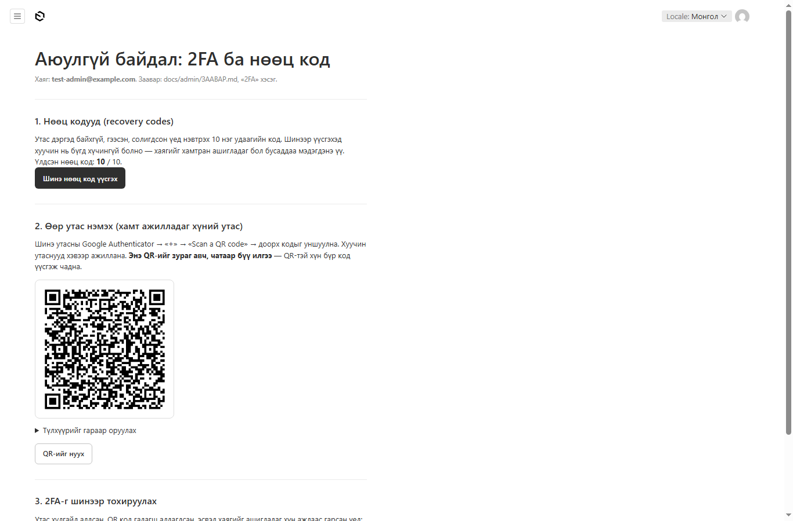

**Анхаар:**
- QR кодыг **зураг авч, мессенжер/имэйлээр бүү илгээ** — QR-тэй хэн ч код үүсгэж чадна. Зайнаас бол видео дуудлагаар
  биш, уулзаж уншуулна.
- Хүн ажлаас гарвал: **«2FA-г шинээр тохируулах»** (бүх утас шинэ QR) + **нууц үгийг солих** (баруун дээд дүрс →
  Account → **Change Password**).
- Цаашид хүн бүрт тусдаа хаяг нээх нь илүү аюулгүй (хэн юу зассаныг Versions-д харуулна). Шинэ хэрэглэгч:
  Хэрэглэгчид (Users) → **Create New**. Шинэ хэрэглэгч анх нэвтрэхэд өөрийн QR гарна.

## 6. Хуудас засах

1. Dashboard дээр бүлгүүд: **Газар нутаг** (аймаг, сум, газар, өвийн газар…), **Түүх, соёл, байгаль**,
   **Нийтлэл, арга хэмжээ**, **Нутгийн үйлчилгээ**, **Зураг**, **Бидний тухай**, **Тохиргоо**.
2. Жишээ нь «Сум (soum)» дээр дарна → жагсаалт. Дээд талын **Search** нүдэнд нэрээр хайна.

3. Мөр дээр дарж засах хуудсыг нээнэ.

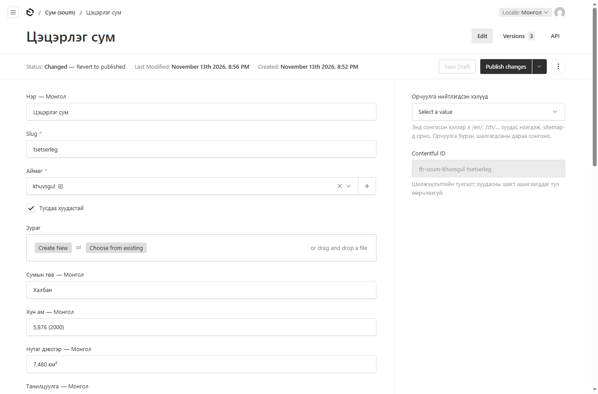

- Талбарын нэрийн ард **«— Монгол»** гэсэн нь тухайн хэлээр бичигдэх талбар (10-р хэсэг).
- **Slug** — хуудасны хаягийн хэсэг (`/province/khuvsgul/tsetserleg`). Нийтлэгдсэн хуудасны slug-ийг **өөрчлөхгүй**
  (хуучин холбоос, Google-ийн индекс эвдэрнэ).
- **Агуулга** (rich text): мөр эхэнд **/** дарж гарчиг (Heading 2/3), жагсаалт, хүснэгт, зураг оруулна. Текстийг
  тодруулж **B**, *I*, холбоос (🔗) нэмнэ.
- **Contentful ID**, **Slug**-ийн доорх саарал талбарууд — системийнх, хөндөхгүй.
- **Versions** таб — өмнөх бүх хувилбар; хуучин хувилбарыг сэргээх боломжтой (**Restore this version**).

## 7. Ноорог хадгалах, preview харах, нийтлэх

Засах хуудасны дээд мөрөнд:

| Товч | Юу хийх |
|---|---|
| **Save Draft** (ноорог хадгалах) | Өөрчлөлтийг хадгална, **сайтад гарахгүй**. Хэдэн ч удаа дарж болно |
| **Publish changes** (нийтлэх) | Сайтад гаргана. Хэдэн секундийн дотор шинэчлэгдэнэ |
| **▾** (Publish-ийн хажуу) | **Schedule Publish** — тодорхой цагт автоматаар нийтлэх |
| **Status: Changed — Revert to published** | Нийтлэгдээгүй өөрчлөлт байна; «Revert…» дарвал ноорогийг хаяж нийтлэгдсэн хувилбар руу буцна |
| **Status: Published — Unpublish** | Хуудсыг сайтаас авна (устгахгүй). **⋮ → Delete** — бүр мөсөн устгана |

**Preview харах (ноорог сайт дээр ямар харагдахыг):**
- **Preview сайт** (`….vercel.app`) **ноорог хувилбарыг** харуулдаг. **Save Draft** дараад preview сайт дээр тухайн
  хуудсыг (жишээ `…vercel.app/province/khuvsgul/tsetserleg`) нээж, хуудсыг шинэчилнэ (F5).
- Production (`travelhubmongolia.com`) зөвхөн **нийтлэгдсэн** хувилбарыг харуулна.
- Хангалттай бол **Publish changes**.

**Ажлын дүрэм:** том засварыг эхлээд Save Draft → preview-ээр шалгах → Publish. Жижиг үсгийн алдааг шууд Publish
хийж болно.

## 8. Шинэ нийтлэл нэмэх

1. Dashboard → **Нийтлэл, арга хэмжээ → «Нийтлэл, түүх (Story)»** (эсвэл карт дээрх **+**).
2. Баруун дээд **Create New**.

3. Бөглөх:
   - **Гарчиг** — монголоор.
   - **Slug** — латинаар, жижиг үсэг, зураасаар: `dadal-altargana-nair` (зай, кирилл, том үсэг хэрэглэхгүй).
   - **Сэдэв** — жагсаалтаас.
   - **Агуулга** — текст; **/** дарж гарчиг, зураг оруулна.
   - **Зураг** — нүүр зураг (9-р хэсэг).
   - **Холбоотой газар**, **Байршил** г.м. — байгаа бол.
4. **Save Draft** → preview-ээр шалгах → **Publish changes**.

Бусад төрөл (Арга хэмжээ, Газар, Аялагчийн зөвлөмж…) ижил аргаар.

## 9. Зураг оруулах

**Аргын 1 — засаж буй хуудаснаас (хурдан):** «Зураг» талбарт **Create New** → файлаа сонгох (эсвэл чирж оруулах) →
alt текст бичих → **Save**. Байгаа зургаас сонгох бол **Choose from existing**.

**Аргын 2 — Зургийн сан:** Dashboard → **Зураг → Зургууд** → **Create New**.

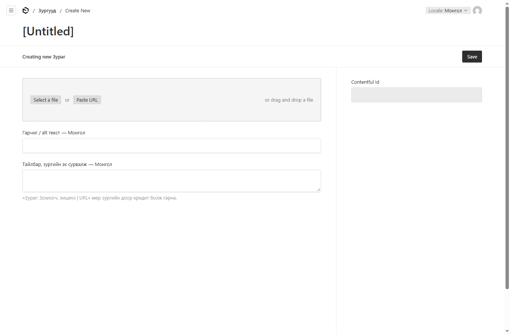

- **Select a file** эсвэл чирж оруулна. JPG/PNG/WebP, **25 MB хүртэл**. Хэвтээ зургийг **≥ 1600 px** өргөнтэй.
  Систем автоматаар 480/960/1600/2400 px WebP хувилбар үүсгэнэ.
- **Гарчиг / alt текст** — зураг дээр юу байгааг 1 өгүүлбэрээр (жишээ «Хөвсгөл нуурын өвлийн мөс»). Хайлт, хараагүй
  хүмүүст чухал.
- **Тайлбар, зургийн эх сурвалж** — `Зураг: Зохиогч, лиценз | URL` хэлбэрээр; сайт дээр зургийн доор гарна.
- Зөвхөн **эрх нь танайх эсвэл чөлөөт лицензтэй** (CC BY, CC BY-SA, Unsplash г.м.) зураг оруулна.
- Голлох хэсэг тайрагдахаас сэргийлэх: зураг оруулсны дараа **focal point**-ыг (цэг) голлох хэсэг рүү зөөнө.

## 10. Хэлний хувилбар засах

Сайт 6 хэлтэй: **Монгол** (үндсэн), English, 中文, Русский, 한국어, 日本語.

1. Хуудсыг нээгээд баруун дээд **Locale: Монгол** → хэлээ сонгоно (жишээ **English**).

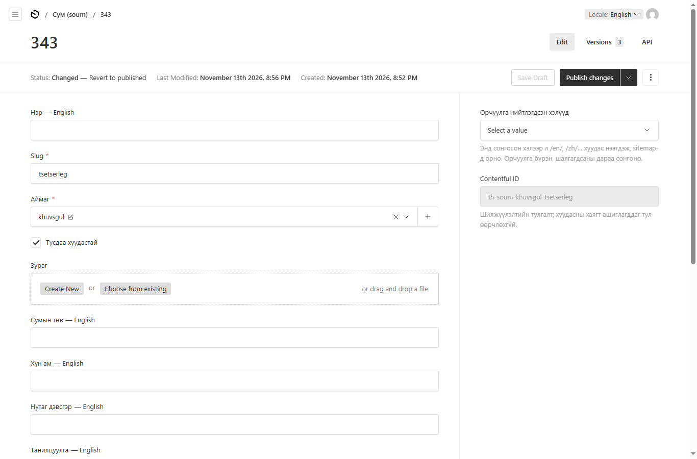

2. Талбарын ард **«— English»** гэж гарна. Хоосон талбар = орчуулаагүй (сайт дээр монголоор гарна).
3. Орчуулгаа бичээд **Save Draft** / **Publish changes**.
4. **«Орчуулга нийтлэгдсэн хэлүүд»** (баруун талд) — тухайн хэл **бүрэн, шалгагдсан** үед л сонгоно. Сонгосон хэлээр
   `/en/…`, `/zh/…` хуудас нээгдэж, sitemap-д орно. Хагас орчуулгыг сонгохгүй.
5. Slug, аймаг, зураг, холбоос зэрэг хэлнээс үл хамаарах талбар бүх хэлэнд нэг — аль ч хэлнээс засахад бүгдэд нөлөөлнө.

**Анхаар:** нийтлэх (Publish) нь **бүх хэлний** өөрчлөлтийг хамт нийтэлнэ. Монгол хувилбарт нийтлэгдээгүй ноорог
байхад англи орчуулгыг нийтлэвэл монгол ноорог ч хамт гарна. Монгол засварыг дуусгаад нийтэлсний дараа орчуулгаа хий.

Нэр томъёо, хэв маяг: `docs/translation/style-guide.md`, `docs/translation/glossary.csv`.

## 11. «Бидний тухай»-д хүн нэмэх

1. Dashboard → **Бидний тухай → «Бидний тухай: хүмүүс»** → **Create New**.

2. Бөглөх:
   - **Нэр** — «Овог Нэр» эсвэл «Нэр Овог» (бүгдэд нэг хэлбэр).
   - **Хэсэг** — **Зөвлөхүүд** / **Гүйцэтгэх баг** / **Уран бүтээлчид**.
   - **Албан тушаал / мэргэжил** — богино (жишээ «Түүхч, доктор (Ph.D)»).
   - **Танилцуулга** — 1–2 өгүүлбэр; карт дээр дарахад гарна.
   - **Зураг** — дөрвөлжин, нүүр голдоо, ≥ 400×400 px. Байхгүй бол нэрийн эхний үсэг дугуйд гарна.
   - **Дараалал** (баруун талд) — тухайн хэсэг дотор бага тоо эхэнд (1, 2, 3…).
3. **Publish changes**. Сайтын `/about-us` хуудас шинэчлэгдэнэ.
4. Хүнийг хасах: Status мөрийн **Unpublish** (түр нуух) эсвэл **⋮ → Delete**.

Тэмдэглэл: CMS-д нэг ч хүн нийтлэгдээгүй үед хуудас жишээ («Нэр Овог») мэдээлэл харуулна. Эхний хүнийг нийтэлмэгц
зөвхөн CMS-ийн хүмүүс гарна. «Бидний тухай» хуудас одоогоор цэсэнд нуугдмал — жинхэнэ мэдээлэл бүрэн болсны дараа
хөгжүүлэгч нээнэ.

## 12. Аюулгүй байдлын дүрэм

- Нууц үг, нөөц кодыг **тусад нь** хадгална (нэг цаасан дээр биш).
- QR кодыг **хэзээ ч** зураг авч илгээхгүй.
- Хуваалцсан хаягийн нууц үгийг хүн ажлаас гарах бүрт солих + 2FA-г шинээр тохируулах.
- Нийтийн компьютерт **Log out**.
- «Нууц үг/кодоо илгээнэ үү» гэсэн имэйл, мессеж ирвэл хариулахгүй — бид хэзээ ч асуухгүй.
- Хаяг байнга түгжигдэж байвал (хэн нэгэн нууц үг таах оролдлого) хөгжүүлэгчид мэдэгдэнэ.

## 13. Түгээмэл асуудал

| Асуудал | Шийдэл |
|---|---|
| «Код буруу байна» | Утасны цаг **автомат** (Settings → Date & time → Automatic) эсэхийг шалгана. Шинэ код гартал хүлээж дахин |
| «Хэт олон буруу оролдлого» | 15 минут хүлээнэ |
| Нууц үгээ мартсан | «Forgot password» имэйл илгээдэггүй (имэйл тохиргоо байхгүй). Өөр админ Users → таны хэрэглэгч → **Change Password**; ганц админ бол хөгжүүлэгчид хандана |
| Бүх утас, нөөц код алга | Өөр админ Users → тухайн хэрэглэгч → **«2FA-г шинэчлэх»**. Ганц админ бол хөгжүүлэгч DB-ээс 2FA-г цэвэрлэнэ (14-р хэсэг) |
| Нийтэлсэн ч сайт дээр хуучин | 1–2 минут хүлээгээд хуудсыг F5. Хэвээр бол хөгжүүлэгчид |
| Зураг оруулахад алдаа | Файл 25 MB-аас бага, JPG/PNG/WebP эсэх |
| `…/admin/create-first-user` production дээр алдаа өгнө | Зориуд хаасан. Хэрэглэгчийг preview дээр, эсвэл Users → Create New-ээр |

## 14. Техникийн тэмдэглэл (хөгжүүлэгчид)

- **2FA:** `payload-totp` 3.0.7 (`forceSetup: true`, payload.config.ts-ийн хамгийн сүүлийн plugin) — бүх collection-ий
  access-ийг «2FA-гаар баталгаажсан сесс» шалгалтаар ороодог. Нийтийн уншилт (content, media, team) `custom.totp.
  disableAccessWrapper.read` + `publishedOrUser`-ээр хадгалагдсан. Сайт Local API (`overrideAccess`) ашигладаг тул нөлөөгүй.
- **Монгол хуудсууд:** `payload/admin/TwoFactorViews.tsx` (`/admin/setup-totp`, `/admin/verify-totp`, `/admin/security`) —
  plugin-ийн англи хуудсыг config-ийн `admin.components.views`-ээр дарсан; endpoint (`/api/setup-totp`, `/api/verify-totp`)
  нь plugin-ийх. `proxy.ts` нь `/admin`-д `x-pathname` header тавина (plugin-д хэрэгтэй).
- **Нөөц код:** `payload/security/twoFactor.ts` — `/api/users/recovery-codes`, `/api/users/use-recovery-code`,
  `/api/users/reset-totp`. Зөвхөн HMAC-SHA256 (PAYLOAD_SECRET) хадгална (`users.recovery_codes`). Нөөц кодоор
  баталгаажихад plugin-ийн `payload-totp` cookie-г (HS256 JWT `{userId, originalStrategy}`) яг plugin шиг бичнэ —
  **plugin шинэчлэхэд `dist/setCookie.js`-ийн формат өөрчлөгдсөн эсэхийг шалгах.**
- **Lockout:** `maxLoginAttempts: 5`, `lockTime: 15 мин` — нууц үг, 2FA код (plugin-ийн `totp_attempts`), нөөц код
  (`loginAttempts/lockUntil`) гурвуулаа. **Session:** `tokenExpiration` 4 цаг, cookie `Secure` (production), `SameSite=Lax`.
  Анхаар: хуваалцсан нэг хаягийг гадны хүн 5 буруу нууц үгээр 15 мин түгжиж чадна (DoS) — хүн бүрт тусдаа хаяг нь
  үүнийг бууруулна.
- **robots:** `app/robots.ts` → `Disallow: /admin`, admin meta `noindex`, `next.config.js` → `X-Robots-Tag: noindex`,
  `X-Frame-Options: SAMEORIGIN`.
- **Анхны хэрэглэгч:** Payload `first-register` хэрэглэгч байвал 403. Нэмэлт хамгаалалт: `VERCEL_ENV=production` үед
  нэвтрээгүй хүсэлтээр хэрэглэгч үүсгэхийг хаасан (`PAYLOAD_ALLOW_FIRST_USER=1`-ээр түр нээнэ). Хэрэглэгчийг кодоор
  үүсгэхгүй.
- **Эрх:** `payload/collections.ts` → `ALL_USERS_ADMIN = true` (role нуугдмал, хадгалах бүрт `admin`). Editor/translator-ыг
  идэвхжүүлэх: `false` болгоход л болно — access функцууд бэлэн.
- **serverURL** зөвхөн `VERCEL_ENV=production` үед (preview-д redirect/CSRF production руу заагдахгүйн тулд).
- **Яаралтай 2FA цэвэрлэх** (ганц админ бүх утас, кодоо алдсан): Neon SQL Editor →
  `UPDATE users SET totp_secret = NULL, recovery_codes = NULL WHERE email = '…';` → дараагийн нэвтрэлтэд шинэ QR.
- **Migration:** `20261124_024225_admin_2fa` (totp_secret, recovery_codes, totp_attempts, role → admin),
  `20261124_024919_team`. Vercel build (`scripts/vercel-build.sh`) автоматаар ажиллуулна.
- **Туршилт** (2026-11-24, локал Postgres + `next start`): анхны бүртгэл → QR → код → 10 нөөц код → гарах/нэвтрэх →
  нөөц кодоор нэвтрэх (дахин ашиглахад татгалзсан) → TOTP; нэвтрээгүй REST нийтлэгдсэнийг уншина, хэрэглэгчийн
  жагсаалт 403; хоёр дахь first-register 403; 2FA-гүй сесс users 403, ноорог 0, нөөц код үүсгэх 401; 5 буруу код →
  нууц үгийн нэвтрэлт түгжигдсэн. 23/23.
